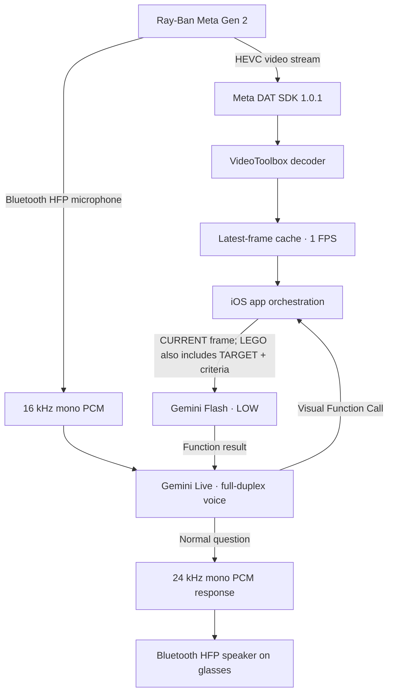
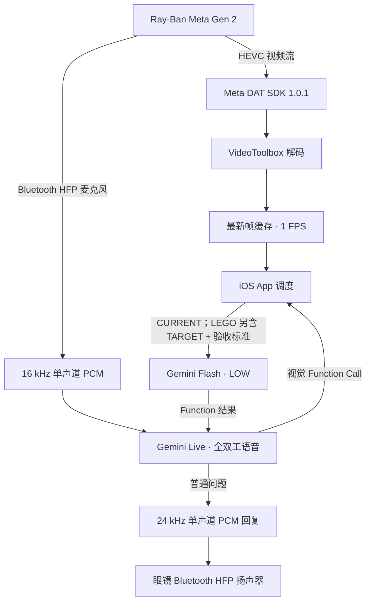

# Meta Glasses + Gemini Live Copilot

A research prototype that connects **Ray-Ban Meta Gen 2** glasses to **Gemini Live** for full-duplex voice interaction and on-demand visual reasoning. It includes two assistant modes: a general audio/visual copilot and an eight-step LEGO assembly tutor.

> **Status:** Experimental iOS project · Version 2.4 · Build 6 · Meta Wearables DAT iOS SDK 1.0.1
>
> This is an independent research project. It is not affiliated with or endorsed by Meta, Google, or the LEGO Group.

[中文说明 / Chinese README](#中文说明)

## Highlights

- **Glasses-first audio:** microphone input and speaker output must both use the glasses' Bluetooth HFP route. The app fails closed if either route is unavailable; it does not silently fall back to the iPhone microphone or speaker.
- **Full-duplex conversation:** the glasses microphone remains active while Gemini is speaking. Gemini Live server VAD and `START_OF_ACTIVITY_INTERRUPTS` handle user barge-in; interrupted playback is stopped locally.
- **Video-stream vision:** reads the latest decoded frame from the glasses' HEVC video stream. There is no standalone photo-capture path in this build.
- **On-demand visual reasoning:** Gemini Live calls an app tool only when visual input is needed. The app sends the latest frame to Gemini Flash (LOW), then returns the result to the original Live session.
- **Two modes:** General A/V Assistant and LEGO Assistant (eight steps, target reference images, written acceptance criteria, and local step-state validation).
- **Experiment logging:** saves the visual Function Call inputs, exact requests, raw Flash responses, and normalized results for export. Ordinary cached frames are not continuously written to disk.

## System overview



### Assistant modes

| Mode | Live responsibilities | Flash responsibilities |
|---|---|---|
| General A/V | Voice conversation; calls `inspect_current_scene` for visual questions | Understands the latest glasses frame and returns a concise visual result |
| LEGO tutor | Teaches the eight-step build; calls `request_step_verification` when a step needs checking | Compares CURRENT frame with the matching TARGET AFTER image and written acceptance criteria |

The app returns Flash's result through the original Function Call response so Gemini Live can speak the final answer. The LEGO state machine advances only when its verification criteria pass.

## Tested configuration in this project

| Component | Configuration |
|---|---|
| Glasses | Ray-Ban Meta Gen 2 |
| iOS target | iOS 17.2 deployment target; physical iPhone required for hardware testing |
| Meta SDK | `meta-wearables-dat-ios`, exact version `1.0.1` |
| Video codec | HEVC `hvc1` |
| DAT stream | High resolution, 720 × 1280, requested 15 FPS |
| Local visual cache | 1 FPS; JPEG quality 0.9 |
| Gemini Live | `models/gemini-3.8-live` |
| Gemini Flash | `gemini-3.8-flash`, LOW thinking level |
| Audio input | Glasses Bluetooth HFP, 16 kHz mono Int16 PCM |
| Audio output | 24 kHz mono PCM routed to glasses Bluetooth HFP |

The DAT frame rate is the glasses-to-phone stream setting. The app's visual cache samples at 1 FPS, and a frame is sent to Flash only when a visual Function Call occurs. Gemini Live does **not** receive a continuous video-frame stream in this implementation.

## Requirements

- A Mac with Xcode. The project targets iOS 17.2; use an Xcode version compatible with the installed Meta DAT SDK. Meta's current iOS setup guidance lists Xcode 26.4+ for its current sample apps.
- A physical iPhone and Ray-Ban Meta Gen 2 glasses. The iOS Simulator cannot validate the real Bluetooth HFP and glasses camera paths.
- The Meta AI companion app installed, the glasses paired, and **Developer Mode** enabled in Meta AI (Settings → Your glasses → Developer Mode).
- Internet access and a Gemini API key with access to the model IDs configured in `GeminiConfig.swift`.
- An Apple Development Team for code signing.

Useful upstream documentation:

- [Meta Wearables DAT iOS SDK](https://github.com/facebook/meta-wearables-dat-ios)
- [Meta Wearables Developer Center](https://developers.meta.com/wearables/)
- [Meta DAT setup guide](https://developers.meta.com/wearables/device-access-toolkit/)
- [Gemini Live API overview](https://ai.google.dev/gemini-api/docs/live-api)
- [Gemini API keys and security](https://ai.google.dev/gemini-api/docs/api-key)

## Publish this project to GitHub (maintainers)

The repository is intended to be created as an **empty public repository** before the first push. For the prepared release, use:

- Owner: `GatechLW`
- Repository: `meta-glasses-gemini-live-copilot`
- Visibility: Public
- Default branch: `main`

When creating it on GitHub, leave **Add a README**, **Add .gitignore**, and **Choose a license** set to **None**. Then extract this package, open Terminal in the extracted project root, and run:

```bash
bash publish_to_github.sh
```

The script stages the project, creates the initial commit, sets the HTTPS remote, and pushes `main`. GitHub authentication is handled by your local Git credential manager. It does not store or request a GitHub token.

## Quick start

1. Clone this repository:

   ```bash
   git clone https://github.com/GatechLW/meta-glasses-gemini-live-copilot.git
   cd meta-glasses-gemini-live-copilot
   ```

2. Open `iPhoneGeminiVideoLab/MetaGlassesGeneralAV.xcodeproj` in Xcode.
3. Select the app target → **Signing & Capabilities**. Choose your Apple Development Team and replace the example bundle identifier `com.example.metaglassescopilot` with an identifier you control.
4. Confirm the Swift Package dependency `https://github.com/facebook/meta-wearables-dat-ios` resolves to **Exact Version 1.0.1**. Xcode should add `MWDATCore` and `MWDATCamera` to the app target.
5. Connect a physical iPhone, select it as the run destination, then build and run.
6. Install/open the Meta AI app, pair the glasses, and enable Developer Mode. In this app, tap **Meta AI 注册 / 授权** and complete the registration hand-off.
7. Paste your own Gemini API key into the app's **Gemini API Key** field and tap **保存**. The key is stored in the iOS Keychain; do not put it in source code or commit it.
8. Select **通用音视频助手** or **LEGO 搭建**, then tap Start.
9. Before testing a conversation, confirm the diagnostic panel reports both microphone and speaker on the Meta glasses Bluetooth HFP route (the app reports `STRICT HFP OK`).

### Meta Developer Mode configuration

The checked-in `Info.plist` intentionally has `MetaAppID = 0` and an empty `ClientToken`, which is the Developer Mode configuration supported by Meta's DAT setup guidance. For a production/release-channel integration, use the app ID and client token issued in the Wearables Developer Center and set the Apple Team ID as required by Meta. Do not commit private production credentials.

The app URL callback scheme is `metaglassescopilot`; if you change it, keep the URL scheme and `MWDAT.AppLinkURLScheme` in `Info.plist` consistent.

## How to test

### 1. Strict glasses audio and barge-in

- Start either assistant mode with the glasses connected.
- Confirm **both** Mic and Speaker show the Meta glasses Bluetooth HFP route.
- Ask a question while Gemini is speaking. The new user utterance should interrupt the previous response.
- If HFP input or output is lost, the app should stop the session rather than switching to iPhone audio.

### 2. General A/V Assistant

- Ask a normal, non-visual question: Live should answer directly.
- Ask about an object, text, or scene in front of the glasses: Live should call `inspect_current_scene`.
- Confirm the app uses the latest decoded video-stream frame, sends it to Flash LOW, and returns the result to Live for spoken delivery.

### 3. LEGO Assistant

- Select LEGO mode and say **“开始”**.
- Follow the eight-step tutorial.
- When a step is complete, say **“搭好了，帮我检查一下”**.
- Confirm the request contains the CURRENT frame, matching TARGET AFTER reference image, and written acceptance criteria. The local state machine should advance only after a passing verification result.

### 4. Offline package checks

From the repository root:

```bash
python3 verify_package.py
```

This script checks required source/resources, the eight-step tutorial assets, the two visual pipelines, strict HFP requirements, full-duplex interruption behavior, removal of standalone photo capture, and Xcode resource references. Swift syntax and plist checks run when the corresponding tools are available.

## Troubleshooting

| Symptom | Things to check |
|---|---|
| Meta registration does not return to the app | Meta AI app is installed; glasses are paired; Developer Mode is enabled; the callback URL scheme is unchanged and consistent in `Info.plist` |
| App refuses to start audio/video | Check the diagnostic panel and confirm both HFP input and output are available; reconnect the glasses and retry |
| Mic or speaker shows iPhone | This build intentionally rejects the iPhone route. Reconnect the glasses and verify Bluetooth HFP is active |
| Gemini connection/model error | Verify the API key, account/model access, quota/billing, network reachability, and model IDs in `GeminiConfig.swift` |
| Visual answer is missing | Check that Live emitted the expected Function Call and inspect the exported request/response logs |
| LEGO step does not advance | Check the CURRENT/TARGET images, acceptance criteria, Flash response, and state-machine result in the exported event folder |

## Security and privacy notes

- No Gemini API key is bundled in this repository. Each user must enter their own key in the app; it is stored in the iOS Keychain.
- This is a research/demo client that connects directly to Gemini using a user-provided API key. Keychain storage protects the key at rest, but a key used by a client app is not equivalent to a server-held secret. Do not distribute a personal key or use an unrestricted key. For a production service, use a backend/token-broker design and follow Google's current API-key security guidance.
- Visual event exports can contain camera images and model request/response data. Review them before sharing; do not commit personal recordings, logs, exported ZIPs, or API credentials.
- The included LEGO reference images and tutorial data are demo assets. Confirm you have the right to redistribute them before publishing a public repository; otherwise replace them with assets you own or are licensed to share.

## Validation boundary

The package's static validation script passes in the preparation environment. A successful static check is not a substitute for building with your own Xcode installation or testing on your own iPhone and glasses. Gemini model availability, Meta account eligibility, regional access, quotas, firmware, and SDK behavior may vary over time.

## License

No project license has been added yet. Until the owner selects and adds a license, the repository is **not** automatically open-source licensed; please do not assume permission to redistribute or reuse the code or bundled assets. The Meta DAT SDK and Gemini API are separately governed by their own terms.

---

# 中文说明

这是一个将 **Ray-Ban Meta Gen 2** 眼镜接入 **Gemini Live** 的 iOS 研究原型，支持真正的全双工语音交互，以及按需触发的视觉理解。工程包含两个助手模式：通用音视频助手和八步 LEGO 搭建导师。

## 核心功能

- **严格使用眼镜音频：** 麦克风输入和扬声器输出都必须走眼镜 Bluetooth HFP；任一方向不可用时直接停止，不会静默回退到 iPhone。
- **全双工语音：** Gemini 播报期间，眼镜麦克风仍持续采集；由 Gemini Live 服务端 VAD 和 `START_OF_ACTIVITY_INTERRUPTS` 处理用户打断，客户端同步停止旧播放队列。
- **视频流取帧：** 只从眼镜 HEVC 视频流获取最新解码帧；当前版本不包含独立拍照流程。
- **按需视觉理解：** Gemini Live 判断需要视觉信息时，触发 Function Call；App 将最新帧发送给 Gemini Flash LOW，再把结果返回原 Live 会话。
- **双模式：** 通用音视频助手；LEGO 八步搭建助手（目标参考图、文字验收标准和本地步骤状态机）。
- **实验记录：** 保存视觉 Function Call 使用的图片、实际请求、Flash 原始响应和标准化结果，便于导出分析。普通缓存帧不会持续写入磁盘。

## 系统流程



## 两种助手模式

| 模式 | Gemini Live | Gemini Flash |
|---|---|---|
| 通用音视频助手 | 负责语音对话；视觉问题触发 `inspect_current_scene` | 理解眼镜视频流的最新画面，返回视觉结果 |
| LEGO 助手 | 负责八步语音教学；需要验收时触发 `request_step_verification` | 对比 CURRENT 画面、对应 TARGET AFTER 参考图和文字验收标准 |

Flash 结果通过原 Function Call Response 返回 Live，由 Live 生成最终语音回答。LEGO 状态机只有在验收通过后才进入下一步。

## 当前工程参数

| 项目 | 配置 |
|---|---|
| 眼镜 | Ray-Ban Meta Gen 2 |
| iOS Deployment Target | iOS 17.2；硬件测试必须使用真实 iPhone |
| Meta SDK | `meta-wearables-dat-ios`，Exact 1.0.1 |
| 视频编码 | HEVC `hvc1` |
| DAT 视频流 | High，720 × 1280，请求 15 FPS |
| 本地视觉缓存 | 1 FPS；JPEG quality 0.9 |
| Gemini Live | `models/gemini-3.8-live` |
| Gemini Flash | `gemini-3.8-flash`，LOW thinking level |
| 音频输入 | 眼镜 Bluetooth HFP，16 kHz 单声道 Int16 PCM |
| 音频输出 | 24 kHz 单声道 PCM，路由至眼镜 Bluetooth HFP |

注意：15 FPS 是眼镜到手机的视频流设置；App 本地以 1 FPS 更新视觉缓存。只有发生视觉 Function Call 时才把最新帧发送给 Flash。本工程不会持续向 Gemini Live 发送视频帧。

## 环境要求

- Mac + Xcode。工程 iOS Deployment Target 为 17.2；请使用与 Meta DAT SDK 兼容的 Xcode。Meta 当前 iOS 示例的配置指南列出 Xcode 26.4+。
- 一台真实 iPhone 和 Ray-Ban Meta Gen 2 眼镜。模拟器无法验证真实 Bluetooth HFP 和眼镜摄像头链路。
- 安装 Meta AI App，完成眼镜配对，并在 Meta AI 中开启 **Developer Mode**（Settings → Your glasses → Developer Mode）。
- 可访问 Gemini API 的网络环境，以及拥有本工程配置模型权限的 Gemini API Key。
- Apple Development Team，用于 Xcode 签名。

官方文档：

- [Meta Wearables DAT iOS SDK](https://github.com/facebook/meta-wearables-dat-ios)
- [Meta Wearables Developer Center](https://developers.meta.com/wearables/)
- [Meta DAT 接入入口](https://developers.meta.com/wearables/device-access-toolkit/)
- [Gemini Live API 概览](https://ai.google.dev/gemini-api/docs/live-api)
- [Gemini API Key 与安全建议](https://ai.google.dev/gemini-api/docs/api-key)

## 快速开始

1. 克隆仓库：

   ```bash
   git clone https://github.com/GatechLW/meta-glasses-gemini-live-copilot.git
   cd meta-glasses-gemini-live-copilot
   ```

2. 使用 Xcode 打开 `iPhoneGeminiVideoLab/MetaGlassesGeneralAV.xcodeproj`。
3. 在 App Target → **Signing & Capabilities** 中选择自己的 Apple Development Team，并将示例 Bundle Identifier `com.example.metaglassescopilot` 修改为自己拥有的 Identifier。
4. 确认 Swift Package `https://github.com/facebook/meta-wearables-dat-ios` 解析到 **Exact Version 1.0.1**，并包含 `MWDATCore` 和 `MWDATCamera`。
5. 连接真实 iPhone，选择该设备，Build & Run。
6. 在 Meta AI App 中完成眼镜配对并开启 Developer Mode。首次运行本 App 时，点击 **Meta AI 注册 / 授权**，完成跳转授权流程。
7. 在 App 的 **Gemini API Key** 输入框中粘贴自己的 API Key，点击 **保存**。Key 会保存在 iOS Keychain；不要写入源代码或提交到 Git。
8. 选择 **通用音视频助手** 或 **LEGO 搭建**，点击 Start。
9. 开始对话前，确认诊断面板中 Mic 和 Speaker 都使用 Meta 眼镜 Bluetooth HFP，并显示 `STRICT HFP OK`。

### Meta Developer Mode 配置说明

仓库中的 `Info.plist` 将 `MetaAppID` 设为 `0`、`ClientToken` 留空，这是 Meta DAT 文档支持的 Developer Mode 配置。若要接入生产发布渠道，需要从 Wearables Developer Center 获取 App ID 和 Client Token，并按 Meta 要求设置 Apple Team ID。不要把生产凭据提交到公开仓库。

App URL callback scheme 当前为 `metaglassescopilot`。如果修改，必须保持 `Info.plist` 中 URL scheme 和 `MWDAT.AppLinkURLScheme` 一致。

## 测试流程

### 1. 检查眼镜音频与打断

- 启动任一助手模式。
- 确认 Mic 和 Speaker 都显示 Meta 眼镜 Bluetooth HFP。
- Gemini 说话期间直接提出新问题，检查是否能打断旧回答。
- 如果 HFP 输入或输出丢失，App 应停止会话，而不是切换到 iPhone 音频。

### 2. 通用音视频助手

- 提出普通问题，确认 Live 直接回答。
- 询问眼镜前方物体、文字或场景，确认 Live 触发 `inspect_current_scene`。
- 确认 App 从视频流获取最新帧，发送给 Flash LOW，再将结果返回 Live 进行语音回答。

### 3. LEGO 助手

- 选择 LEGO 模式，说 **“开始”**。
- 按八步教程搭建。
- 完成某一步后说 **“搭好了，帮我检查一下”**。
- 检查 Flash 请求中是否同时包含 CURRENT、对应 TARGET AFTER 参考图和文字验收标准；只有验收通过才应进入下一步。

### 4. 离线完整性检查

在仓库根目录运行：

```bash
python3 verify_package.py
```

脚本会检查必要源文件和资源、八步教程图片、两种视觉流程、严格 HFP 条件、全双工打断逻辑、独立拍照流程移除情况，以及 Xcode 资源引用。如果环境中存在 Swift / plist 检查工具，也会执行相应检查。

## 常见问题

| 现象 | 检查方向 |
|---|---|
| Meta 注册无法返回 App | 确认已安装 Meta AI、眼镜已配对、Developer Mode 已开启，且 `Info.plist` 的 callback URL scheme 未被错误修改 |
| App 无法启动音视频 | 查看诊断面板，确认 HFP 输入和输出都可用；重新连接眼镜后再试 |
| Mic 或 Speaker 显示为 iPhone | 本版本会拒绝 iPhone 音频路由；请重新连接眼镜并检查 Bluetooth HFP |
| Gemini 连接或模型报错 | 检查 API Key、账号模型权限、配额 / 计费、网络，以及 `GeminiConfig.swift` 中的模型 ID |
| 视觉回答缺失 | 检查 Live 是否触发预期 Function Call，并查看导出的 request / response 日志 |
| LEGO 步骤不前进 | 检查 CURRENT / TARGET 图片、验收标准、Flash 响应和状态机判定 |

## 安全与隐私

- 本仓库不包含 Gemini API Key。每位使用者都需要在 App 内输入自己的 Key，Key 保存在 iOS Keychain。
- 当前是研究 / Demo 客户端，使用用户输入的 Key 直接连接 Gemini。Keychain 保护的是设备静态存储，并不意味着客户端运行时的 Key 等同于服务端秘密。不要分发个人 Key，也不要使用不受限制的 Key。生产环境建议采用后端 / 临时令牌方案，并遵循 Google 最新 API Key 安全指南。
- 视觉事件导出可能包含摄像头画面、模型请求和响应。分享前请检查内容；不要把个人录制、日志、导出 ZIP 或 API 凭据提交到仓库。
- 仓库中的 LEGO 参考图片和教程数据是 Demo 资源。公开发布前请确认拥有再分发权；如无权分享，请替换为自己拥有或明确获准使用的素材。

## 验证边界

本次整理环境中，工程自带的静态完整性检查脚本通过。静态检查不能替代使用自己的 Xcode 编译，也不能替代真实 iPhone 和眼镜测试。Gemini 模型可用性、Meta 账号资格、地区开放情况、配额、固件和 SDK 行为都可能随时间变化。

## License / 许可证

当前尚未添加项目许可证。在作者选择并添加许可证之前，**本仓库不会自动获得开源许可证**；请勿默认拥有复制、再分发或复用代码及素材的权利。Meta DAT SDK 和 Gemini API 还分别受其自身条款约束。
